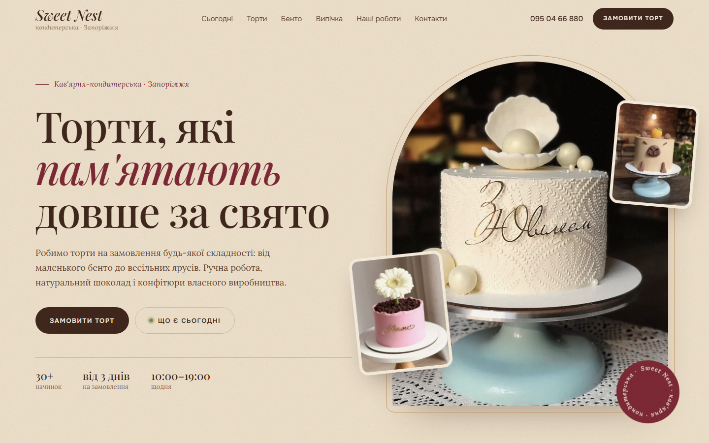
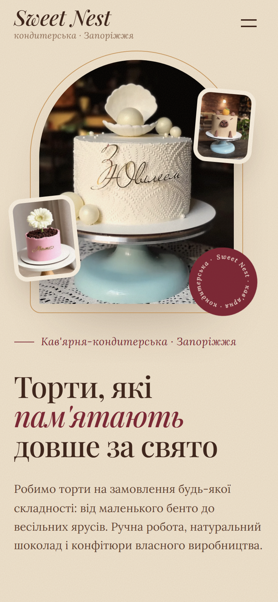
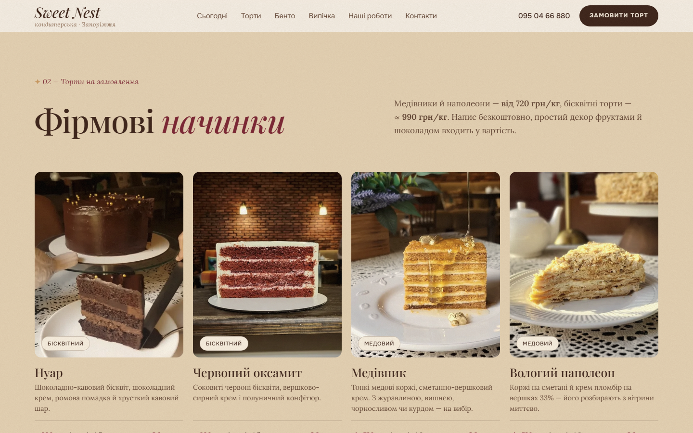
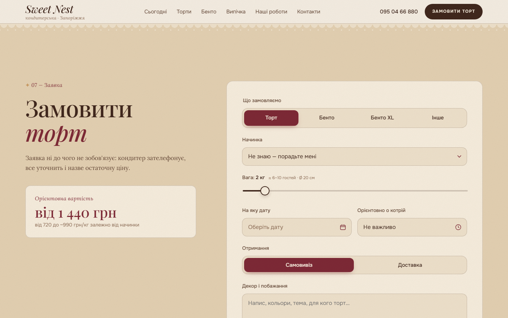
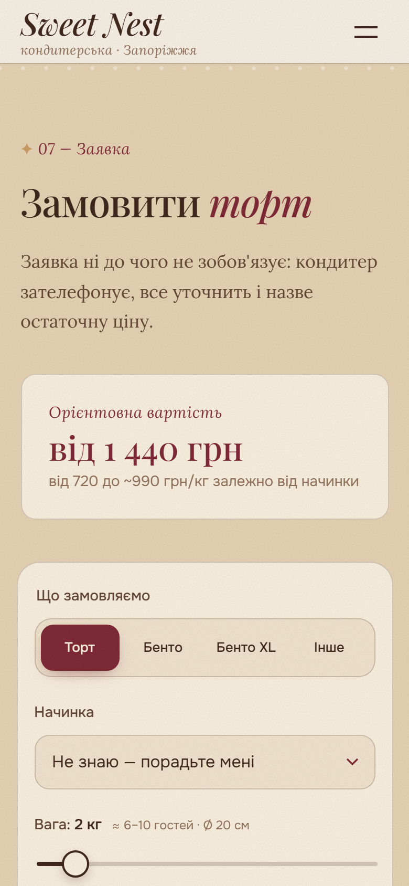

# Sweet Nest — bakery site with cake orders to Telegram

Website for a café-confectionery in Zaporizhzhia, Ukraine: today's showcase, signature fillings,
bento cakes, a gallery of finished work and an order form that sends requests straight to the
confectioner's Telegram. The owner runs the whole site from a Telegram bot, no developer needed.

**Live:** https://sweetnest.pages.dev

  
  &nbsp;
  

## Menu

Signature fillings with photos, composition and price per kilogram, in a retro-vintage style:
chocolate, burgundy and sand, paper grain, sepia photos.

  

## Ordering a cake

The form counts an approximate price while the customer picks the type, filling, weight and date.
Selects and the calendar are custom-drawn to match the design.

  
  &nbsp;
  

## What it does

- "Today in the showcase" block that the owner updates from the phone
- 50+ fillings, bento cakes, savoury pastry, gallery of finished cakes, reviews
- Order form with a live price estimate, weight hint by number of guests, allergy field
- Orders arrive in Telegram to every admin at once
- Admin bot: showcase, permanent menu, fillings, prices, photos, order settings, undo
- "Silent film" transitions between sections
- SEO: structured data for a bakery, sitemap, Search Console
- Checked on 8 devices: desktop, Android, iPhone, iPad
- Free hosting, no monthly fees

## Stack

JavaScript, Cloudflare Pages + Functions, Cloudflare KV, Telegram Bot API

> Source code is private. Want a site like this for your business? Message me.
